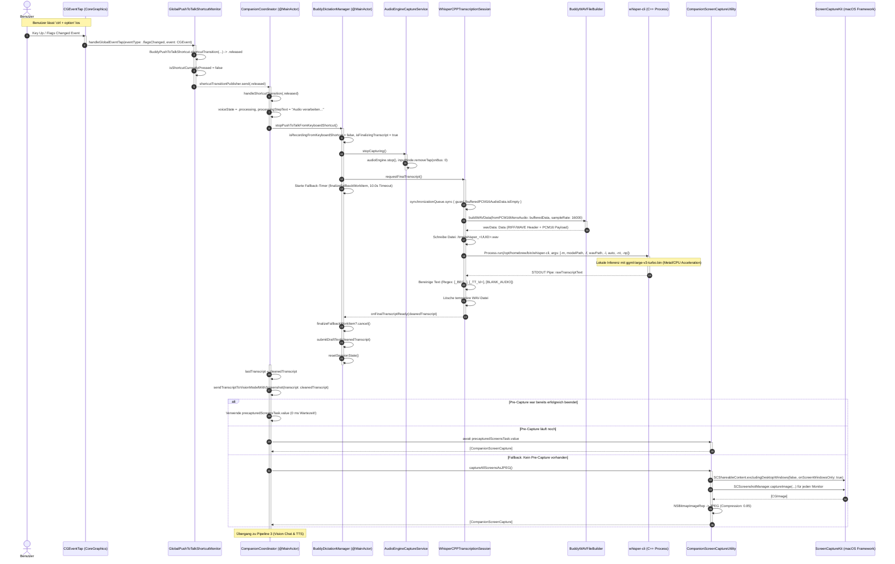
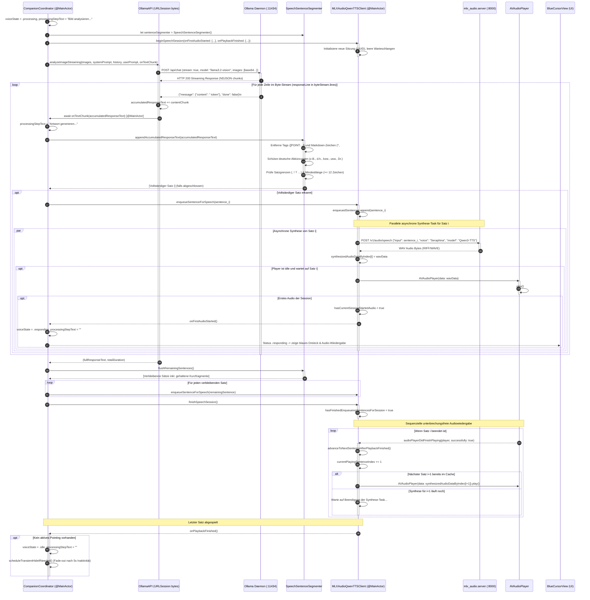
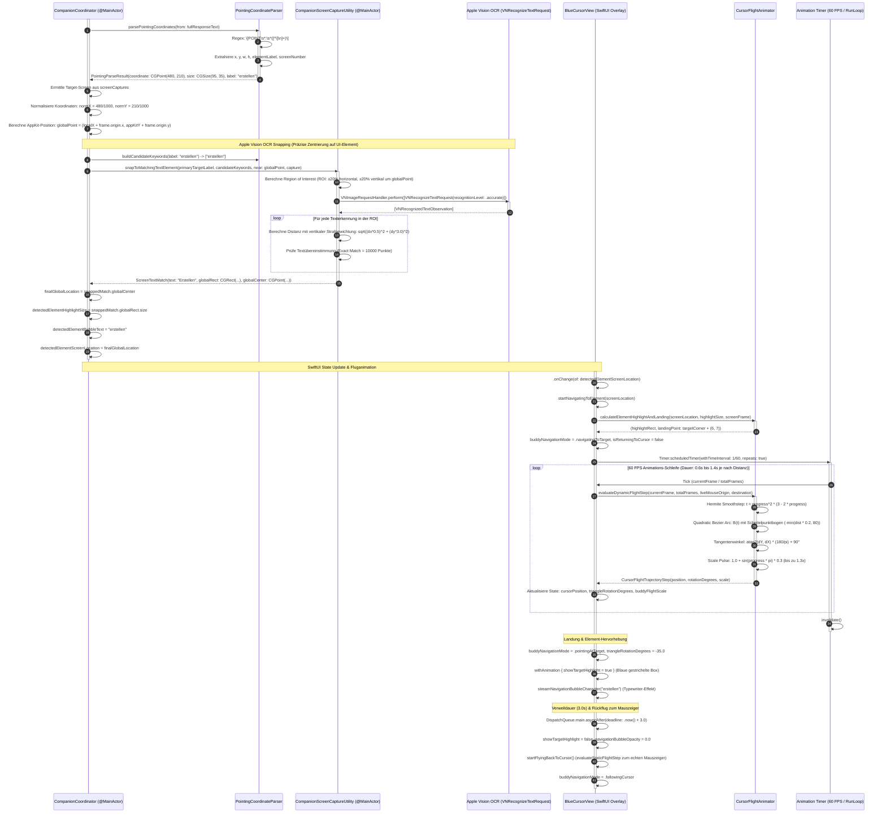
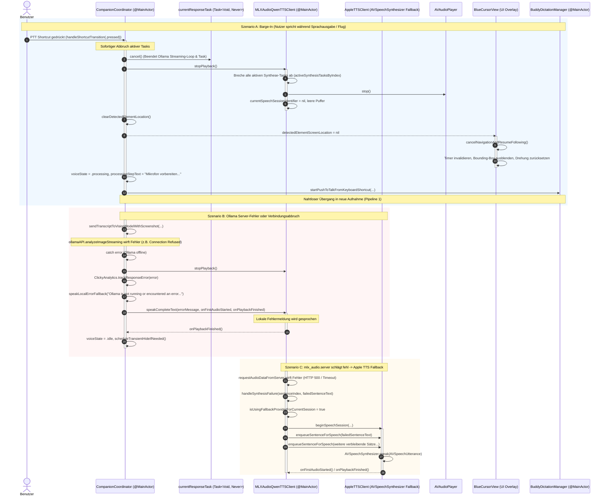

# Architektur: UML-Sequenzdiagramme der Clicky-Datenverarbeitungspipelines

Dieses Dokument enthält detaillierte UML-Sequenzdiagramme (`sequenceDiagram`) für sämtliche Kern-Workflows und Datenverarbeitungspipelines der Clicky-Anwendung (`leanring-buddy`). Die Diagramme basieren direkt auf den realen Swift-Implementierungen, ihren Concurrency-Modellen (`@MainActor`, `async`/`await`, `Task`, CoreGraphics RunLoop Source), Datenstrukturen und Fehlerbehandlungsmechanismen.

---

## Inhaltsverzeichnis

1. [Pipeline 1: Global Push-To-Talk & Audio Recording](#pipeline-1-global-push-to-talk--audio-recording)
2. [Pipeline 2: Key Release, Screen Capture & Whisper STT](#pipeline-2-key-release-screen-capture--whisper-stt)
3. [Pipeline 3: Multimodal Vision Chat & Streaming Speech Synthesis](#pipeline-3-multimodal-vision-chat--streaming-speech-synthesis)
4. [Pipeline 4: Pointing Detection, Apple Vision OCR & Bezier Flight Physics](#pipeline-4-pointing-detection-apple-vision-ocr--bezier-flight-physics)
5. [Pipeline 5: Barge-In Interruption & Error Handling](#pipeline-5-barge-in-interruption--error-handling)

---

## Pipeline 1: Global Push-To-Talk & Audio Recording

### Übersicht
Diese Pipeline beschreibt den Vorgang vom Drücken des systemweiten Hotkeys (`ctrl + option`) über das Starten der Mikrofonaufnahme mittels `AVAudioEngine`, die parallele Vorab-Bildschirmerfassung (Pre-Capture) zur Latenzreduktion bis hin zur Berechnung der Audio-Wellenform und deren Darstellung im SwiftUI-Cursor-Overlay.

```mermaid
sequenceDiagram
    autonumber
    actor User as Benutzer
    participant CG as CGEventTap (CoreGraphics / CFMachPort)
    participant PTT as GlobalPushToTalkShortcutMonitor
    participant Coord as CompanionCoordinator (@MainActor)
    participant OverlayMgr as OverlayWindowManager (@MainActor)
    participant ScreenUtil as CompanionScreenCaptureUtility (@MainActor)
    participant Dict as BuddyDictationManager (@MainActor)
    participant AudioEng as AudioEngineCaptureService (AVAudioEngine)
    participant PowerMeter as AudioPowerMeter
    participant WhisperSession as WhisperCPPTranscriptionSession
    participant CursorView as BlueCursorView / Waveform (SwiftUI)

    Note over User,CG: Benutzer drückt 'ctrl + option'
    User->>CG: Key Down / Flags Changed Event (Modifikatoren aktiv)
    activate CG
    CG->>PTT: handleGlobalEventTap(eventType: .flagsChanged, event: CGEvent)
    deactivate CG
    activate PTT
    PTT->>PTT: BuddyPushToTalkShortcut.shortcutTransition(...) -> .pressed
    PTT->>PTT: isShortcutCurrentlyPressed = true
    PTT-->>Coord: shortcutTransitionPublisher.send(.pressed) [DispatchQueue.main]
    deactivate PTT

    activate Coord
    Coord->>Coord: handleShortcutTransition(.pressed)
    
    opt Overlay nicht sichtbar (Transient Mode)
        Coord->>OverlayMgr: showOverlay(onScreens: NSScreen.screens, companionManager: self)
        OverlayMgr->>OverlayMgr: Erzeuge/Positioniere borderless NSPanels (.floating, .canJoinAllSpaces)
        Coord->>Coord: isOverlayVisible = true
    end

    Note over Coord: Barge-In: Vorherige Tasks & Audio stoppen
    Coord->>Coord: currentResponseTask?.cancel()
    Coord->>Coord: stopVoicePreview()
    Coord->>Coord: clearDetectedElementLocation()
    Coord->>Coord: voiceState = .processing, processingStepText = "Mikrofon vorbereiten..."

    par Latenzoptimierung: Bildschirm-Precapture starten
        Coord->>ScreenUtil: precapturedScreensTask = Task { captureAllScreensAsJPEG() }
        activate ScreenUtil
        ScreenUtil-->>Coord: Async Task gestartet (erfasst Screens parallel zur Sprache)
        deactivate ScreenUtil
    and Audio-Aufnahmesitzung starten
        Coord->>Dict: startPushToTalkFromKeyboardShortcut(...)
        activate Dict
        Dict->>Dict: isPreparingToRecord = true
        Dict->>Dict: requestMicrophoneAndSpeechPermissionsWithoutDuplicatePrompts()
        Dict->>WhisperSession: startStreamingSession(keyterms: [...])
        activate WhisperSession
        WhisperSession-->>Dict: Instanz von WhisperCPPTranscriptionSession
        deactivate WhisperSession

        Dict->>AudioEng: startCapturing(bufferHandler: { buffer in ... })
        activate AudioEng
        AudioEng->>AudioEng: inputNode.installTap(onBus: 0, bufferSize: 1024, format: inputFormat)
        AudioEng->>AudioEng: audioEngine.start()
        AudioEng-->>Dict: Erfolgreich gestartet
        deactivate AudioEng

        Dict->>Dict: isRecordingFromKeyboardShortcut = true, isPreparingToRecord = false
        Dict-->>Coord: Combine Sink: isRecording == true -> voiceState = .listening
        deactivate Dict
    end
    deactivate Coord

    Note over AudioEng,CursorView: Kontinuierlicher Audio-Streaming-Loop während Spracheingabe
    loop Für jeden Audiopuffer (1024 Frames, ~44.1/48 kHz AVAudioPCMBuffer)
        AudioEng->>Dict: bufferHandler(audioBuffer: AVAudioPCMBuffer)
        activate Dict
        
        par Audio-Pufferung für Transkription
            Dict->>WhisperSession: appendAudioBuffer(audioBuffer)
            activate WhisperSession
            WhisperSession->>WhisperSession: audioPCM16Converter.convertToPCM16Data(from: audioBuffer)
            WhisperSession->>WhisperSession: bufferedPCM16AudioData.append(pcm16Data) [16 kHz Mono]
            deactivate WhisperSession
        and RMS & Wellenform-Pegelberechnung
            Dict->>PowerMeter: calculatePowerLevel(from: audioBuffer, boostMultiplier: 10.2)
            activate PowerMeter
            PowerMeter->>PowerMeter: calculateRootMeanSquare(floatChannelData[0])
            PowerMeter-->>Dict: boostedLevel: Float (0.0 ... 1.0)
            deactivate PowerMeter
            
            Dict->>Dict: Glättung: max(boostedLevel, currentAudioPowerLevel * 0.72)
            Dict->>Dict: currentAudioPowerLevel = smoothedLevel
            Dict-->>Coord: Combine Sink: coordinator.currentAudioPowerLevel = powerLevel
            Coord-->>CursorView: @ObservedObject companionManager.currentAudioPowerLevel
            activate CursorView
            CursorView->>CursorView: BlueCursorWaveformView rendert 5 animierte Balken via TimelineView (36-60 FPS)
            deactivate CursorView
        end
        deactivate Dict
    end
```



### Technische Erläuterung & Latenzbetrachtungen

1. **Ereignisüberwachung via `CGEventTap`**:
   - Die Überwachung der Modifikatortasten (`ctrl + option`) erfolgt über einen `listenOnly`-Event-Tap auf Session-Ebene (`kCGSessionEventTap`).
   - Da die Callback-Funktion direkt in den `CFRunLoopGetMain()` eingebunden ist, werden Tastenzustandsänderungen mit minimaler Latenz (< 2 ms) im Hauptthread abgefangen.

2. **Parallele Bildschirmerfassung (Pre-Capture)**:
   - Anstatt erst nach dem Loslassen der Taste mit der Bildschirmerfassung zu beginnen, startet `CompanionCoordinator` unmittelbar beim `pressed`-Event eine asynchrone Task:
     ```swift
     precapturedScreensTask = Task { @MainActor in
         try await CompanionScreenCaptureUtility.captureAllScreensAsJPEG()
     }
     ```
   - Dadurch wird die Bildschirmerfassung via ScreenCaptureKit (Dauer ca. 80–180 ms je nach Monitoranzahl und Auflösung) vollständig parallel zur Audioaufnahme des Nutzers ausgeführt. Sobald der Nutzer fertig gesprochen hat, liegt der Screenshot bereits im Speicher vor – Latenzgewinn: **100 % der Screenshot-Erfassungszeit**.

3. **Audio-Erfassung & RMS-Berechnung**:
   - `AudioEngineCaptureService` installiert einen Bus-0-Tap auf der `AVAudioInputNode` mit einer Puffergröße von 1024 Frames (ca. 21–23 ms Audiodaten pro Puffer).
   - In `AudioPowerMeter` wird der Root Mean Square (RMS) des ersten Audiokanals berechnet:
     $$\text{RMS} = \sqrt{\frac{1}{N}\sum_{i=0}^{N-1} s_i^2}$$
     Dieser Wert wird mit `boostMultiplier = 10.2` skaliert und auf den Bereich $[0.0, 1.0]$ normiert.
   - `BuddyDictationManager` wendet eine exponentielle Abklingglättung an (`smoothed = max(boosted, current * 0.72)`), um ein unruhiges Flackern der UI-Wellenform in `BlueCursorWaveformView` zu verhindern.

---

## Pipeline 2: Key Release, Screen Capture & Whisper STT

### Übersicht
Beim Loslassen der Tastenkombination wird die Mikrofonerfassung sofort gestoppt. Die gepufferten Audiodaten werden zu einer 16-kHz-Mono-WAV-Datei zusammengesetzt, an das lokale `whisper-cli`-Binary übergeben und transkribiert. Parallel wird das vorab erfasste Screenshot-Ergebnis abgeholt und die visuelle KI-Pipeline initiiert.



### Technische Erläuterung & Datentransformationen

1. **Audio-Serialisierung**:
   - `AudioEngineCaptureService` liefert Samples im nativen Hardware-Format (häufig 44.1 kHz oder 48 kHz Float32).
   - `BuddyPCM16AudioConverter` konvertiert diese in Echtzeit über `AVAudioConverter` in 16.000 Hz, 16-Bit Signed Integer Linear PCM (Mono).
   - Beim Loslassen der Taste konstruiert `BuddyWAVFileBuilder` einen standardkonformen 44-Byte RIFF/WAVE-Header und speichert die Datei im RAM-basierten temporären Dateisystem (`FileManager.default.temporaryDirectory`).

2. **Inferenz mit Whisper C++**:
   - Ausführung des nativen CLI-Tools `whisper-cli`:
     ```bash
     whisper-cli -m models/ggml-large-v3-turbo.bin -f /tmp/whisper_XYZ.wav -l auto -nt -np
     ```
     `-nt` unterdrückt Zeitstempelmarkierungen, `-np` unterdrückt Fortschrittsbalken.
   - Textbereinigung filtert interne Token-Tags (`\[_BEG_\]`, `\[_TT_\d+\]`, `\[BLANK_AUDIO\]`) per Regular Expression heraus.

3. **Multi-Monitor ScreenCaptureKit Geometrie**:
   - Bildschirme werden deterministisch von links nach rechts (`origin.x`) sortiert, sodass Bildschirmindizes über Sitzungen hinweg stabil bleiben.
   - Die Bildschirmkoordinaten werden zwischen dem AppKit-System (Nullpunkt unten links) und Core Graphics (Nullpunkt oben links) exakt abgeglichen.
   - Die Cursorposition zum Aufnahmezeitpunkt (`NSEvent.mouseLocation`) wird normalisiert ($0\dots 1000$) in das Label des primären Bildschirms eingebettet:
     `"screen 1 — user's cursor is currently at [450,320]"`

---

## Pipeline 3: Multimodal Vision Chat & Streaming Speech Synthesis

### Übersicht
Sobald Transkript und Screenshots vorliegen, streamt `OllamaAPI` die Antwort zeilenweise als NDJSON. Der `SpeechSentenceSegmenter` extrahiert vollständige Sätze, entfernt Steuerbefehle wie `[POINT:...]` und übermittelt die Sätze an den `MLXAudioQwenTTSClient`. Dieser synthetisiert die Sätze asynchron und parallel über `mlx_audio.server`, sodass die Sprachausgabe bereits beginnt, während das Vision-LLM noch generiert.



### Technische Erläuterung & Segmentierungslogik

1. **Streaming-Architektur (`SpeechSentenceSegmenter`)**:
   - LLMs generieren Text tokenweise. Ein Warten auf die vollständige Antwort würde eine Latenz von 3–8 Sekunden bedeuten.
   - Der `SpeechSentenceSegmenter` verarbeitet ausschließlich neu hinzugekommene Skalare (`newlyAppendedScalars`).
   - **Tag-Stripping im Stream**: Befindet sich der Parser innerhalb von `[...]`, werden die Zeichen verworfen, sodass Koordinatentags wie `[POINT:450,210:erstellen]` niemals vom TTS vorgelesen werden.
   - **Abkürzungserkennung**: Eine feste Menge deutscher und englischer Abkürzungen (`z.B.`, `d.h.`, `u.a.`, `bzw.`, `usw.`, `ca.`, `Dr.`, `Prof.`, `e.g.`) wird erkannt. Ein Punkt nach einer solchen Abkürzung löst **keinen** Satzabschluss aus.
   - **Minimale/Maximale Latenzgrenzen**:
     - `minimumSentenceCharacterCount = 12`: Verhindert abgehackte Mini-Fragmente ("ja.", "klar.").
     - `maximumPendingCharacterCountBeforeCommaSplit = 220`: Teilt lange Schachtelsätze am letzten Komma, um die Time-to-First-Audio (TTFA) unter 1,5 Sekunden zu halten.

2. **Parallele Vorab-Synthese (`MLXAudioQwenTTSClient`)**:
   - Jeder emittierte Satz startet sofort einen eigenständigen HTTP-Request gegen `mlx_audio.server`.
   - Die resultierenden WAV-Puffer werden in `synthesizedAudioDataByIndex: [Int: Data]` indiziert abgelegt.
   - Der `AVAudioPlayer` spielt die Sätze sequenziell ab. Da Satz $N+1$ synthetisiert wird, während Satz $N$ noch abgespielt wird, entsteht eine nahtlose, unterbrechungsfreie Sprachausgabe.

---

## Pipeline 4: Pointing Detection, Apple Vision OCR & Bezier Flight Physics

### Übersicht
Nach Abschluss der LLM-Generierung parst der `PointingCoordinateParser` das `[POINT:...]`-Tag. Die normalisierten Koordinaten ($0\dots 1000$) werden in Bildschirmkoordinaten umgerechnet. Zur Beseitigung von KI-Ungenauigkeiten führt Apple Vision (`VNRecognizeTextRequest`) ein lokales OCR-Snapping auf den echten Button-Rahmen durch. Anschließend berechnet `CursorFlightAnimator` eine Bezier-Kurve mit dynamischer Drehung und Skalierung, die `BlueCursorView` mit 60 FPS abfliegt.



### Technische Erläuterung & Mathematische Modelle

1. **Apple Vision OCR Snapping (`VNRecognizeTextRequest`)**:
   - Da Vision-LLMs Koordinaten mit einer gewissen Varianz schätzen, nutzt Clicky das native Apple Vision Framework für eine pixelgenaue Justierung:
   - **Region of Interest (ROI)**: Eingrenzung auf $\pm 20\%$ der Displayabmessungen um den Schätzwert, um Rechenzeit zu minimieren.
   - **Vertikal gewichtete Distanzfunktion**:
     $$d_{\text{eff}} = \sqrt{(0.5 \cdot \Delta x)^2 + (3.0 \cdot \Delta y)^2}$$
     *Hintergrund*: In modernen UIs (Menüs, Listen, Symbolleisten) liegen Elemente vertikal dicht beieinander (oft nur 20–30 pt Zeilenhöhe). Eine vertikale Abweichung führt leicht zum falschen UI-Element, während eine horizontale Abweichung meist innerhalb desselben Buttons liegt.
   - **Harte Schranken**: Kandidaten weiter als 140 pt horizontal oder 70 pt vertikal werden strikt ignoriert (`guard effectiveDistance <= 120.0`).

2. **Bezier-Flugkurven-Physik (`CursorFlightAnimator`)**:
   - **Hermite-Interpolation (Smoothstep)**:
     $$S(t) = 3t^2 - 2t^3 \quad \text{mit } t = \frac{\text{frame}}{\text{totalFrames}}$$
   - **Dynamische quadratische Bezier-Kurve**:
     $$B(t) = (1-t)^2 P_0 + 2(1-t)t P_1 + t^2 P_2$$
     Wobei $P_0$ der (während des Flugs mitbewegte) Mausursprung ist, $P_2$ der Zielpunkt und $P_1$ der Kontrollpunkt mit adaptiver Bogenhöhe:
     $$h_{\text{arc}} = \min(0.2 \cdot \text{distance}, 80.0\text{ pt})$$
   - **Ausrichtung (Tangentenrotation)**:
     $$\theta = \text{atan2}(B'_y(t), B'_x(t)) \cdot \frac{180^\circ}{\pi} + 90^\circ$$
     Das blaue Dreieck richtet seine Spitze exakt entlang des Flugvektors aus.
   - **Skalierungs-Puls (Flugdynamik)**:
     $$s(t) = 1.0 + 0.3 \cdot \sin(t \cdot \pi)$$
     Verleiht dem Cursor beim Scheitelpunkt einen dreidimensionalen "Sprung"-Effekt ($1.3\times$).

---

## Pipeline 5: Barge-In Interruption & Error Handling

### Übersicht
Clicky unterstützt ein sofortiges Unterbrechen laufender Prozesse (Barge-In): Sobald der Benutzer die Push-to-Talk-Taste drückt, während noch Text generiert, Sprache wiedergegeben oder ein Zeigevorgang animiert wird, werden alle Netzwerk- und Audio-Tasks sofort abgebrochen. Ebenso existieren robuste Fallback-Ketten für Serverausfälle (Ollama, MLX Audio).



### Technische Erläuterung & Sicherheitsgarantien

1. **Barge-In Koordination**:
   - Durch das Zuweisen von `currentResponseTask = Task { ... }` in `CompanionCoordinator` kann die gesamte Generierungskette jederzeit via `currentResponseTask?.cancel()` cooperativ abgebrochen werden.
   - Alle Loops in `OllamaAPI`, `CompanionScreenCaptureUtility` und `SpeechSentenceSegmenter` prüfen regelmäßig `guard !Task.isCancelled else { return }`.
   - `MLXAudioQwenTTSClient.stopPlayback()` bricht laufende `URLSession`-Tasks über ein Dictionary ab (`activeSynthesisTasksByIndex`) und stoppt den `AVAudioPlayer` unmittelbar.
   - `BlueCursorView` invalidiert seinen `navigationAnimationTimer` und versetzt das System ohne Animationsartefakte zurück in den Modus `.followingCursor`.

2. **Mehrstufige Fallback-Strategie für Sprachausgabe (TTS)**:
   - **Stufe 1 (Lokal / High Quality)**: Qwen3-TTS via `mlx_audio.server` (0.6B / 1.7B Parameter, Apple Silicon Metal-optimiert).
   - **Stufe 2 (System-Fallback)**: Sollte der lokale MLX-Server abstürzen, nicht gestartet sein oder ein Satz-Timeout auftreten, schaltet `MLXAudioQwenTTSClient.handleSynthesisFailure` mitten in der Sitzung transparent auf `AppleTTSClient` (`AVSpeechSynthesizer`) um.
   - Der Benutzer erhält die Antwort unterbrechungsfrei über die native Systemstimme von macOS.

3. **Deterministisches Aufräumen (Resource Leak Prevention)**:
   - Alle `AVAudioEngine`-Taps, `CFMachPort`-Event-Taps, temporäre WAV-Dateien (`defer { removeItem(...) }`) und `Combine`-Subscriptions (`AnyCancellable`) sind an den App- und Session-Lebenszyklus gebunden, um Memory Leaks und verwaiste Audio-Ressourcen im System vollständig auszuschließen.
