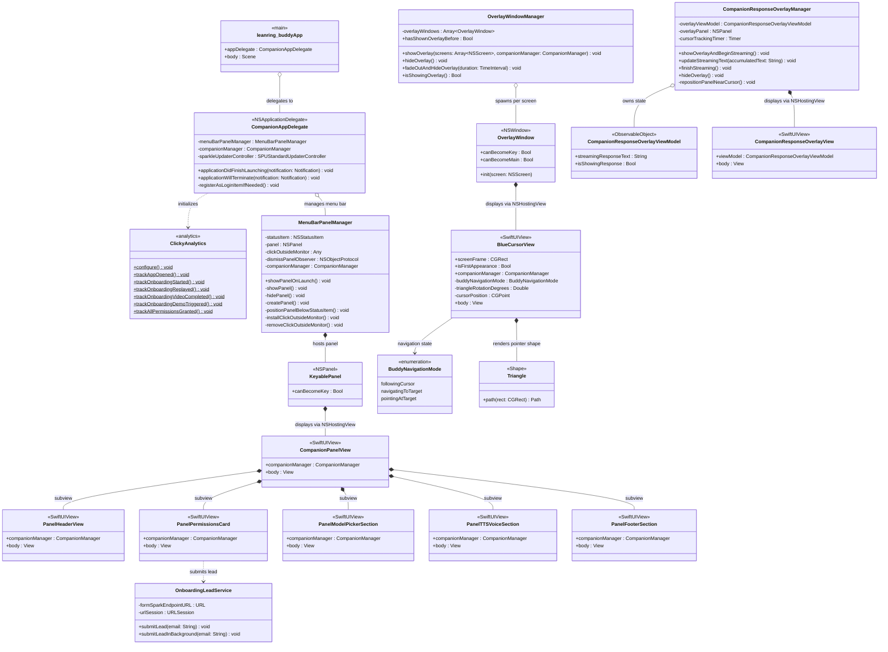

# Architektur: UML-Klassendiagramme der Clicky-Systemarchitektur

Dieses Dokument stellt die technische Architektur der macOS-Begleiter-App **Clicky** (`leanring-buddy`) anhand von detaillierten UML-Klassendiagrammen dar. Die Diagramme basieren direkt auf dem refaktorierten Swift-Code der Clean Architecture und veranschaulichen die Struktur der Protokolle, Domänenmodelle, State Machines, Services sowie der Benutzeroberfläche.

---

## Inhaltsverzeichnis

1. [Architekturüberblick & Entwurfsmuster](#architekturüberblick--entwurfsmuster)
   - [Dependency Injection & Protokoll-Abstraktion](#dependency-injection--protokoll-abstraktion)
   - [Observer Pattern & Reaktive UI (@Published / Combine)](#observer-pattern--reaktive-ui-published--combine)
   - [Typealias für Abwärtskompatibilität](#typealias-für-abwärtskompatibilität)
   - [Zustandsautomat & Barge-In-Lifecycle](#zustandsautomat--barge-in-lifecycle)
   - [AppKit-zu-SwiftUI Bridging](#appkit-zu-swiftui-bridging)
2. [Diagramm 1: Core Protocols, Models & State Coordinator](#diagramm-1-core-protocols-models--state-coordinator)
3. [Diagramm 2: Audio Capture, Dictation & Speech Synthesis Services](#diagramm-2-audio-capture-dictation--speech-synthesis-services)
4. [Diagramm 3: Vision LLM, Screen Capture & Pointing Services](#diagramm-3-vision-llm-screen-capture--pointing-services)
5. [Diagramm 4: UI-Hierarchie (MenuBarPanel & Multi-Screen CursorOverlay)](#diagramm-4-ui-hierarchie-menubarpanel--multi-screen-cursoroverlay)
6. [Zusammenfassung der Schnittstellen & Typen](#zusammenfassung-der-schnittstellen--typen)

---

## Architekturüberblick & Entwurfsmuster

Clicky ist als reine macOS-Menüleistenanwendung konzipiert (`LSUIElement = true`), die ohne Hauptfenster oder Dock-Icon auskommt. Um höchste Testbarkeit, Modularität und Wartbarkeit zu gewährleisten, folgt die Codebasis einer sauberen Schichtenarchitektur (Clean Architecture & MVVM):

```
leanring-buddy/
├── Core/            # Reine Domänenmodelle, Enums & Protokollabstraktionen
│   ├── Models/      # CompanionVoiceState, PointingDetection, TTSModelCatalog
│   └── Protocols/   # PermissionsManaging, SettingsStoring, ScreenCapturing, etc.
├── State/           # Zentraler Zustandsautomat: CompanionCoordinator
├── Services/        # Konkrete Service-Implementierungen nach Fähigkeiten gegliedert
│   ├── Audio/           # Mikrofonaufnahme, RMS-Metering, Shortcut-Tap
│   ├── ScreenCapture/   # ScreenCaptureKit Multi-Monitor-Screenshot & OCR
│   ├── SpeechSynthesis/ # MLX Audio (Qwen3/Kokoro), Apple TTS, Satz-Segmentierer
│   ├── Transcription/   # Whisper C++, Apple Speech, AssemblyAI, OpenAI
│   ├── VisionAndAI/     # Lokale Ollama-Vision-Inferenz, Claude/OpenAI Fallbacks
│   ├── Storage/         # UserDefaults-Persistenz
│   ├── System/          # Systemberechtigungen & Fensterplatzierung
│   └── Analytics/       # PostHog Telemetrie & Lead-Erfassung
├── UI/              # Dekomponierte SwiftUI-Views & AppKit-Fensterhosts
│   ├── MenuBarPanel/    # NSStatusItem, modales Panel & Komponenten
│   ├── CursorOverlay/   # Transparente Multi-Screen NSWindows & Zeigeranimation
│   └── DesignSystem/    # Atomare Farb-, Typografie- und Metrik-Tokens
└── App/             # App-Einstiegspunkt (@main) & Bundle-Konfiguration
```

### Dependency Injection & Protokoll-Abstraktion
Sämtliche Kernfähigkeiten (Transkription, Sprachsynthese, Bildschirmaufnahme, Vision-Chat, Berechtigungsverwaltung, Einstellungen) sind über Swift-Protokolle im Namensraum `Core/Protocols/` definiert. Konkrete Implementierungen werden dem zentralen `CompanionCoordinator` per Initializer übergeben. In Produktionsumgebungen greifen parametrisierte Defaults und Factory-Methoden (`TextToSpeechProviderFactory`, `BuddyTranscriptionProviderFactory`). In Tests erlauben In-Memory-Mocks (`MockPermissionsManager`, `MockSettingsStorage`, `MockScreenCaptureUtility`, `MockTextToSpeechProvider`, `MockTranscriptionProvider`, `MockVisionChatService`) eine 100%ige Testabdeckung ohne Netzwerkzugriff, Dateisystemabhängigkeiten oder physische Audio-Hardware.

### Observer Pattern & Reaktive UI (@Published / Combine)
Der `CompanionCoordinator` dient als Single Source of Truth und implementiert `ObservableObject` unter `@MainActor`-Isolation. Statusänderungen (Sprachzustand, Mikrofonpegel, Permissions, Erkennungskoordinaten) werden als `@Published`-Eigenschaften deklariert. SwiftUI-Views (`CompanionPanelView`, `BlueCursorView`) abonnieren diese automatisch. Asynchrone Hintergrundquellen (z. B. der `CGEventTap` für Push-to-Talk-Hotkeys oder der `AVAudioEngine`-Puffertap) senden Ereignisse über `Combine`-Publisher (`PassthroughSubject`), die im Coordinator reaktiv zusammengeführt werden.

### Typealias für Abwärtskompatibilität
Um bestehenden UI-Komponenten und Tests den unterbrechungsfreien Zugriff zu ermöglichen, stellt `leanring-buddy/CompanionManager.swift` folgenden Typalias bereit:
```swift
public typealias CompanionManager = CompanionCoordinator
```
Dadurch konnte die gesamte Codebasis auf das Coordinator-Muster umgestellt werden, ohne dass hunderte Aufrufstellen in SwiftUI-Views angepasst werden mussten.

### Zustandsautomat & Barge-In-Lifecycle
Die Interaktion wird durch den Enum `CompanionVoiceState` formalisiert:
$$\text{idle} \longrightarrow \text{listening} \longrightarrow \text{processing} \longrightarrow \text{responding} \longrightarrow \text{idle}$$
Drückt der Anwender während einer aktiven Antwort erneut die Sprechtaste (`ctrl + option`), greift der **Barge-In-Mechanismus**: Laufende Tasks (`currentResponseTask?.cancel()`) werden sofort abgebrochen, die Sprachsynthese wird gestoppt (`textToSpeechProvider.stopPlayback()`) und der Flugcursor kehrt ansatzlos zum Mauszeiger zurück.

### AppKit-zu-SwiftUI Bridging
Da Menüleisten-Apps spezielle Fensteranforderungen besitzen (rahmenlos, klickdurchlässig, Space-übergreifend), kommen `NSPanel`- und `NSWindow`-Subklassen (`KeyablePanel`, `OverlayWindow`) zum Einsatz. Deren Arbeitsbereich wird durch `NSHostingView` mit nativen SwiftUI-Komponenten befüllt. Die Zeigerüberlagerung nutzt das Level `.screenSaver`, um selbst Vollbildanwendungen und Submenüs zuverlässig zu überlagern.

---

## Diagramm 1: Core Protocols, Models & State Coordinator

Dieses Diagramm beschreibt die zentralen Protokolle der Kernschicht, die Domänenmodelle, den Zustandskoordinator `CompanionCoordinator` sowie die zugehörigen Fabriken und Storage-Adapter.

```mermaid
classDiagram
    direction TB

    class CompanionVoiceState {
        <<enumeration>>
        idle
        listening
        processing
        responding
    }

    class PermissionsManaging {
        <<protocol>>
        +allPermissionsGranted : Bool
        +hasAccessibilityPermission : Bool
        +hasScreenRecordingPermission : Bool
        +hasMicrophonePermission : Bool
        +hasScreenContentPermission : Bool
        +refreshPermissions() void
        +startPolling(onChange: VoidCallback) void
        +stopPolling() void
        +markScreenContentPermissionGranted() void
    }

    class SettingsStoring {
        <<protocol>>
        +string(key: String) String
        +set(value: String, key: String) void
        +double(key: String) Double
        +set(value: Double, key: String) void
        +bool(key: String) Bool
        +set(value: Bool, key: String) void
    }

    class ScreenCapturing {
        <<protocol>>
        +captureScreens() Array~CompanionScreenCapture~
    }

    class VisionChatService {
        <<protocol>>
        +streamChat(prompt: String, screenCaptures: Array~CompanionScreenCapture~, history: Array~Tuple~) AsyncThrowingStream~String, Error~
        +fetchAvailableModels() Array~String~
    }

    class TextToSpeechProvider {
        <<protocol>>
        +displayName : String
        +isPlaying : Bool
        +hasCurrentSessionStartedAudio : Bool
        +prepare() void
        +shutdown() void
        +beginSpeechSession(onFirstAudioStarted: VoidCallback, onPlaybackFinished: VoidCallback) void
        +enqueueSentenceForSpeech(sentenceText: String) void
        +finishSpeechSession() void
        +stopPlayback() void
        +setVoiceName(voiceName: String) void
        +setModelName(modelName: String) void
        +setLanguageCode(languageCode: String) void
        +setSpeechRateMultiplier(rateMultiplier: Double) void
        +speakCompleteText(completeText: String, onFirstAudioStarted: VoidCallback, onPlaybackFinished: VoidCallback) void
    }

    class BuddyTranscriptionProvider {
        <<protocol>>
        +displayName : String
        +requiresSpeechRecognitionPermission : Bool
        +isConfigured : Bool
        +unavailableExplanation : String
        +startStreamingSession(keyterms: Array~String~, onUpdate: TranscriptCallback, onFinal: TranscriptCallback, onError: ErrorCallback) BuddyStreamingTranscriptionSession
    }

    class BuddyStreamingTranscriptionSession {
        <<protocol>>
        +finalTranscriptFallbackDelaySeconds : TimeInterval
        +appendAudioBuffer(audioBuffer: AVAudioPCMBuffer) void
        +requestFinalTranscript() void
        +cancel() void
    }

    class PointingParseResult {
        <<struct>>
        +spokenText : String
        +coordinate : CGPoint
        +size : CGSize
        +elementLabel : String
        +screenNumber : Int
        +parse(responseText: String)$ PointingParseResult
    }

    class PointingCoordinateParser {
        <<enumeration>>
        +parsePointingCoordinates(responseText: String)$ PointingParseResult
        +buildCandidateKeywords(label: String)$ Array~String~
    }

    class TTSLanguageOption {
        <<struct>>
        +id : String
        +displayName : String
        +code : String
    }

    class TTSModelOption {
        <<struct>>
        +id : String
        +displayName : String
        +shortName : String
        +modelRepo : String
        +isLocalMLX : Bool
        +supportedLanguages : Array~TTSLanguageOption~
        +defaultLanguageCode : String
        +availableVoices : Array~String~
        +defaultVoice : String
    }

    class TTSModelCatalog {
        <<enumeration>>
        +qwen3_06B$ : TTSModelOption
        +qwen3_17B$ : TTSModelOption
        +kokoro_82M$ : TTSModelOption
        +appleSpeech$ : TTSModelOption
        +allModels$ : Array~TTSModelOption~
        +defaultModelId$ : String
        +model(modelId: String)$ TTSModelOption
    }

    class CompanionCoordinator {
        <<ObservableObject>>
        +voiceState : CompanionVoiceState
        +lastTranscript : String
        +currentAudioPowerLevel : CGFloat
        +processingStepText : String
        +hasAccessibilityPermission : Bool
        +hasScreenRecordingPermission : Bool
        +hasMicrophonePermission : Bool
        +hasScreenContentPermission : Bool
        +isRequestingScreenContent : Bool
        +detectedElementScreenLocation : CGPoint
        +detectedElementDisplayFrame : CGRect
        +detectedElementBubbleText : String
        +detectedElementHighlightSize : CGSize
        +isOverlayVisible : Bool
        +isClickyCursorEnabled : Bool
        +selectedModel : String
        +availableVisionModels : Array~String~
        +selectedTTSModelId : String
        +selectedTTSLanguageCode : String
        +selectedVoice : String
        +isPlayingVoicePreview : Bool
        +speechRateMultiplier : Double
        +onboardingPromptText : String
        +onboardingPromptOpacity : Double
        +showOnboardingPrompt : Bool
        +hasSubmittedEmail : Bool
        +permissionsManager : PermissionsManaging
        +settingsStorage : SettingsStoring
        +textToSpeechProvider : TextToSpeechProvider
        +allPermissionsGranted : Bool
        +hasCompletedOnboarding : Bool
        +hasActiveUserInteractionOrBackgroundProcess : Bool
        +start() void
        +stop() void
        +simulateStartListening() void
        +simulateStartResponding() void
        +simulateStartProcessing(stepText: String) void
        +simulateTransition(newState: CompanionVoiceState) void
        +sendTranscriptToVisionModelWithScreenshot(transcript: String) void
        +setSelectedTTSModel(modelId: String) void
        +setSelectedTTSLanguage(languageCode: String) void
        +setSelectedVoice(voiceName: String) void
        +playVoicePreview(voiceName: String) void
        +stopVoicePreview() void
        +setSpeechRateMultiplier(rateMultiplier: Double) void
        +setSelectedModel(modelName: String) void
        +refreshAvailableVisionModels() void
        +setClickyCursorEnabled(enabled: Bool) void
        +submitEmail(email: String) void
        +refreshAllPermissions() void
        +requestScreenContentPermission() void
        +triggerOnboarding() void
        +clearDetectedElementLocation() void
    }

    class CompanionManager {
        <<typealias>>
    }

    class UserDefaultsSettingsStorage {
        -defaults : UserDefaults
        +string(key: String) String
        +set(value: String, key: String) void
        +double(key: String) Double
        +set(value: Double, key: String) void
        +bool(key: String) Bool
        +set(value: Bool, key: String) void
    }

    class PermissionsManager {
        +hasAccessibilityPermission : Bool
        +hasScreenRecordingPermission : Bool
        +hasMicrophonePermission : Bool
        +hasScreenContentPermission : Bool
        +allPermissionsGranted : Bool
        -settingsStorage : SettingsStoring
        +refreshPermissions() void
        +startPolling(onChange: VoidCallback) void
        +stopPolling() void
        +markScreenContentPermissionGranted() void
    }

    class TextToSpeechProviderFactory {
        <<factory>>
        +makeDefaultProvider()$ TextToSpeechProvider
    }

    class BuddyTranscriptionProviderFactory {
        <<factory>>
        +makeDefaultProvider()$ BuddyTranscriptionProvider
    }

    CompanionCoordinator --> CompanionVoiceState : publishes state
    CompanionCoordinator o-- PermissionsManaging : injects
    CompanionCoordinator o-- SettingsStoring : injects
    CompanionCoordinator o-- TextToSpeechProvider : injects
    CompanionCoordinator ..> PointingCoordinateParser : parses tags
    CompanionCoordinator ..> TTSModelCatalog : configures voices
    CompanionCoordinator ..> CompanionManager : aliased by

    PermissionsManager ..|> PermissionsManaging : implements
    PermissionsManager o-- SettingsStoring : uses for persistence
    UserDefaultsSettingsStorage ..|> SettingsStoring : implements

    TTSModelCatalog *-- TTSModelOption : contains
    TTSModelOption *-- TTSLanguageOption : supports
    PointingCoordinateParser ..> PointingParseResult : creates

    TextToSpeechProviderFactory ..> TextToSpeechProvider : instantiates
    BuddyTranscriptionProviderFactory ..> BuddyTranscriptionProvider : instantiates
    BuddyTranscriptionProvider ..> BuddyStreamingTranscriptionSession : creates
```



### Erläuterungen zu Diagramm 1

1. **`CompanionCoordinator`**: Zentraler Zustandskoordinator der Anwendung. Er verwaltet den Lebenszyklus von Audioaufnahme, LLM-Inferenz, Bildschirmaufnahmen und visueller Zeigerführung. Seine `@Published`-Variablen spiegeln den Gesamtzustand wider und steuern reaktiv die UI.
2. **`PermissionsManaging` & `PermissionsManager`**: Kapselt macOS-Berechtigungsprüfungen (Bedienungshilfen/Accessibility, Bildschirmaufnahme/Screen Recording, Mikrofon, Screen Content) und bietet periodisches Polling mit automatischer UI-Aktualisierung bei Rechteänderungen.
3. **`SettingsStoring` & `UserDefaultsSettingsStorage`**: Entkoppelt die Persistenz von `UserDefaults.standard` über ein testbares Key-Value-Interface.
4. **`TTSModelCatalog`**: Verwaltet den statischen Katalog aller unterstützten Sprachsynthese-Modelle (Qwen3 0.6B/1.7B, Kokoro 82M, Apple Speech), deren Sprachen (`TTSLanguageOption`) und verfügbare Stimmen.
5. **`PointingCoordinateParser`**: Extrahiert formatierte Pointing-Tags wie `[POINT:x,y:w,h:label:screenN]` aus den gestreamten Antworten des Vision-Modells und bereinigt den gesprochenen Text vor der Synthese.

---

## Diagramm 2: Audio Capture, Dictation & Speech Synthesis Services

Dieses Diagramm zeigt die Komponenten der Push-to-Talk-Audioerfassung, die Transkriptions-Pipeline mit ihren austauschbaren Backends sowie die lokale Satz-für-Satz-Sprachsynthese (TTS).

```mermaid
classDiagram
    direction TB

    class AudioEngineCaptureService {
        -audioEngine : AVAudioEngine
        -audioInputBus : AVAudioNodeBus
        -defaultBufferSize : AVAudioFrameCount
        +isRunning : Bool
        +startCapturing(bufferHandler: AudioBufferCallback) void
        +stopCapturing() void
    }

    class AudioPowerMeter {
        <<utility>>
        +defaultBoostMultiplier$ : Float
        +calculateRootMeanSquare(audioBuffer: AVAudioPCMBuffer)$ Float
        +calculatePowerLevel(audioBuffer: AVAudioPCMBuffer, boostMultiplier: Float)$ Float
    }

    class GlobalPushToTalkShortcutMonitor {
        <<ObservableObject>>
        +shortcutTransitionPublisher : PassthroughSubject~ShortcutTransition, Never~
        +isShortcutCurrentlyPressed : Bool
        -globalEventTap : CFMachPort
        -globalEventTapRunLoopSource : CFRunLoopSource
        +start() void
        +stop() void
        -handleGlobalEventTap(eventType: CGEventType, event: CGEvent) CGEvent
    }

    class BuddyPushToTalkShortcut {
        <<namespace>>
        +currentShortcutOption$ : ShortcutOption
        +pushToTalkKeyCode$ : UInt16
        +shortcutTransition(event: NSEvent, wasShortcutPreviouslyPressed: Bool)$ ShortcutTransition
        +shortcutTransition(eventType: CGEventType, keyCode: UInt16, modifierFlagsRawValue: UInt64, wasShortcutPreviouslyPressed: Bool)$ ShortcutTransition
    }

    class BuddyDictationManager {
        <<ObservableObject>>
        +isRecordingFromMicrophoneButton : Bool
        +isRecordingFromKeyboardShortcut : Bool
        +isKeyboardShortcutSessionActiveOrFinalizing : Bool
        +isFinalizingTranscript : Bool
        +isPreparingToRecord : Bool
        +currentAudioPowerLevel : CGFloat
        +recordedAudioPowerHistory : Array~CGFloat~
        +microphoneButtonRecordingStartedAt : Date
        +transcriptionProviderDisplayName : String
        +lastErrorMessage : String
        +currentPermissionProblem : BuddyDictationPermissionProblem
        +isDictationInProgress : Bool
        +isActivelyRecordingAudio : Bool
        +needsInitialPermissionPrompt : Bool
        -transcriptionProvider : BuddyTranscriptionProvider
        -audioEngineCaptureService : AudioEngineCaptureService
        -activeTranscriptionSession : BuddyStreamingTranscriptionSession
        -contextualKeyterms : Array~String~
        +updateContextualKeyterms(keyterms: Array~String~) void
        +startPersistentDictationFromMicrophoneButton(currentDraftText: String, updateDraftText: StringCallback, submitDraftText: StringCallback) void
        +startPushToTalkFromKeyboardShortcut(currentDraftText: String, updateDraftText: StringCallback, submitDraftText: StringCallback) void
        +stopPersistentDictationFromMicrophoneButton() void
        +stopPushToTalkFromKeyboardShortcut() void
        +cancelCurrentDictation(preserveDraftText: Bool) void
        +requestInitialPushToTalkPermissionsIfNeeded() void
        -updateAudioPowerLevel(audioBuffer: AVAudioPCMBuffer) void
    }

    class BuddyTranscriptionProvider {
        <<protocol>>
        +displayName : String
        +requiresSpeechRecognitionPermission : Bool
        +isConfigured : Bool
        +unavailableExplanation : String
        +startStreamingSession(keyterms: Array~String~, onUpdate: TranscriptCallback, onFinal: TranscriptCallback, onError: ErrorCallback) BuddyStreamingTranscriptionSession
    }

    class BuddyStreamingTranscriptionSession {
        <<protocol>>
        +finalTranscriptFallbackDelaySeconds : TimeInterval
        +appendAudioBuffer(audioBuffer: AVAudioPCMBuffer) void
        +requestFinalTranscript() void
        +cancel() void
    }

    class WhisperCPPTranscriptionProvider {
        +displayName : String
        +requiresSpeechRecognitionPermission : Bool
        +isConfigured : Bool
        +unavailableExplanation : String
        -whisperCLIPath$ : String
        -modelFilePath$ : String
        +startStreamingSession(keyterms: Array~String~, onUpdate: TranscriptCallback, onFinal: TranscriptCallback, onError: ErrorCallback) BuddyStreamingTranscriptionSession
    }

    class AppleSpeechTranscriptionProvider {
        +displayName : String
        +requiresSpeechRecognitionPermission : Bool
        +isConfigured : Bool
        +unavailableExplanation : String
        +startStreamingSession(keyterms: Array~String~, onUpdate: TranscriptCallback, onFinal: TranscriptCallback, onError: ErrorCallback) BuddyStreamingTranscriptionSession
    }

    class AssemblyAIStreamingTranscriptionProvider {
        +displayName : String
        +requiresSpeechRecognitionPermission : Bool
        +isConfigured : Bool
        +unavailableExplanation : String
        -sharedWebSocketURLSession : URLSession
        +startStreamingSession(keyterms: Array~String~, onUpdate: TranscriptCallback, onFinal: TranscriptCallback, onError: ErrorCallback) BuddyStreamingTranscriptionSession
    }

    class OpenAIAudioTranscriptionProvider {
        +displayName : String
        +requiresSpeechRecognitionPermission : Bool
        +isConfigured : Bool
        +unavailableExplanation : String
        -apiKey : String
        -modelName : String
        +startStreamingSession(keyterms: Array~String~, onUpdate: TranscriptCallback, onFinal: TranscriptCallback, onError: ErrorCallback) BuddyStreamingTranscriptionSession
    }

    class TextToSpeechProvider {
        <<protocol>>
        +displayName : String
        +isPlaying : Bool
        +hasCurrentSessionStartedAudio : Bool
        +prepare() void
        +shutdown() void
        +beginSpeechSession(onFirstAudioStarted: VoidCallback, onPlaybackFinished: VoidCallback) void
        +enqueueSentenceForSpeech(sentenceText: String) void
        +finishSpeechSession() void
        +stopPlayback() void
        +setVoiceName(voiceName: String) void
        +setModelName(modelName: String) void
        +setLanguageCode(languageCode: String) void
        +setSpeechRateMultiplier(rateMultiplier: Double) void
        +speakCompleteText(completeText: String, onFirstAudioStarted: VoidCallback, onPlaybackFinished: VoidCallback) void
    }

    class MLXAudioQwenTTSClient {
        +displayName : String
        +isPlaying : Bool
        +hasCurrentSessionStartedAudio : Bool
        -modelName : String
        -voiceName : String
        -languageCode : String
        -fallbackTextToSpeechProvider : TextToSpeechProvider
        -serverManager : MLXAudioServerManager
        -networkSession : URLSession
        -currentSpeechSessionIdentifier : UUID
        -enqueuedSentencesInCurrentSession : Array~String~
        -synthesizedAudioDataByIndex : Dictionary
        -activeSynthesisTasksByIndex : Dictionary
        -currentPlayingSentenceIndex : Int
        -activeAudioPlayer : AVAudioPlayer
        +prepare() void
        +shutdown() void
        +beginSpeechSession(onFirstAudioStarted: VoidCallback, onPlaybackFinished: VoidCallback) void
        +enqueueSentenceForSpeech(sentenceText: String) void
        +finishSpeechSession() void
        +stopPlayback() void
        +setVoiceName(newVoiceName: String) void
        +setModelName(newModelName: String) void
        +setLanguageCode(newLanguageCode: String) void
        +setSpeechRateMultiplier(newRateMultiplier: Double) void
        -playAudioForSentenceAtCurrentIndex() void
        -advanceToNextSentenceAfterPlaybackFinished() void
        -handleSynthesisFailure(sentenceIndex: Int, failedSentenceText: String) void
    }

    class MLXAudioServerManager {
        +shared$ : MLXAudioServerManager
        -defaultLocalServerPort$ : Int
        +resolvedPythonExecutablePath$ : String
        +resolvedServerScriptPath$ : String
        +isServerReachable() Bool
        +ensureServerIsRunning() Bool
        +shutdownManagedServerProcess() void
    }

    class AppleTTSClient {
        +displayName : String
        +isPlaying : Bool
        +hasCurrentSessionStartedAudio : Bool
        -speechSynthesizer : AVSpeechSynthesizer
        +prepare() void
        +shutdown() void
        +beginSpeechSession(onFirstAudioStarted: VoidCallback, onPlaybackFinished: VoidCallback) void
        +enqueueSentenceForSpeech(sentenceText: String) void
        +finishSpeechSession() void
        +stopPlayback() void
        +setSpeechRateMultiplier(newRateMultiplier: Double) void
    }

    class ElevenLabsTTSClient {
        -proxyURL : URL
        -session : URLSession
        -audioPlayer : AVAudioPlayer
        +speakText(text: String) void
    }

    class SpeechSentenceSegmenter {
        -minimumSentenceCharacterCount : Int
        -maximumPendingCharacterCountBeforeCommaSplit : Int
        -abbreviationsThatDoNotEndSentences$ : Set~String~
        -pendingSpeakableText : String
        -heldBackShortSentence : String
        +appendAccumulatedText(accumulatedText: String) Array~String~
        +flushPendingSentence() String
        +reset() void
        +splitCompleteTextIntoSentences(text: String)$ Array~String~
    }

    class OnboardingAudioPlayer {
        -audioBundle : Bundle
        -audioResourceName : String
        -audioPlayer : AVAudioPlayer
        -fadeTimer : Timer
        +isPlaying : Bool
        +startOnboardingMusic(initialVolume: Float, playDurationBeforeFade: TimeInterval, fadeOutDuration: TimeInterval) void
        +fadeOutOnboardingMusic(fadeOutDuration: TimeInterval) void
        +stopOnboardingMusic() void
    }

    GlobalPushToTalkShortcutMonitor ..> BuddyPushToTalkShortcut : evaluates keystrokes
    BuddyDictationManager o-- AudioEngineCaptureService : owns capture engine
    BuddyDictationManager o-- BuddyTranscriptionProvider : streams audio to
    BuddyDictationManager ..> AudioPowerMeter : computes audio power levels
    BuddyDictationManager --> BuddyStreamingTranscriptionSession : active session

    WhisperCPPTranscriptionProvider ..|> BuddyTranscriptionProvider : implements
    AppleSpeechTranscriptionProvider ..|> BuddyTranscriptionProvider : implements
    AssemblyAIStreamingTranscriptionProvider ..|> BuddyTranscriptionProvider : implements
    OpenAIAudioTranscriptionProvider ..|> BuddyTranscriptionProvider : implements

    MLXAudioQwenTTSClient ..|> TextToSpeechProvider : implements
    MLXAudioQwenTTSClient o-- TextToSpeechProvider : fallback provider
    MLXAudioQwenTTSClient o-- MLXAudioServerManager : manages server lifecycle
    AppleTTSClient ..|> TextToSpeechProvider : implements

    MLXAudioQwenTTSClient ..> SpeechSentenceSegmenter : uses segmentation
```



### Erläuterungen zu Diagramm 2

1. **Globaler Push-To-Talk Shortcut (`GlobalPushToTalkShortcutMonitor`)**:
   - Installiert einen rein lauschenden CoreGraphics Event Tap (`CGEvent.tapCreate` mit `.cgSessionEventTap` und `.listenOnly`).
   - Reagiert sofort und systemweit auf `ctrl + option` oder `shift + fn`, auch wenn Clicky im Hintergrund läuft.
   - Veröffentlicht Zustandswechsel (`pressed`, `released`) über ein Combine `PassthroughSubject` direkt auf der Haupt-Runloop (`CFRunLoopGetMain()`).
2. **Audio-Erfassung & Metering (`AudioEngineCaptureService`, `AudioPowerMeter`)**:
   - `AudioEngineCaptureService` kapselt `AVAudioEngine` und den InputNode-Tap (`Bus 0`).
   - `AudioPowerMeter` berechnet Root Mean Square (RMS) und normierte Lautstärkepegel (0.0 bis 1.0) zur flüssigen Darstellung der Sprachwellenform im Cursor.
3. **Pluggable Transkription (`BuddyTranscriptionProvider`)**:
   - Standard: `WhisperCPPTranscriptionProvider` führt `whisper-cli` mit dem Modell `large-v3-turbo` 100% lokal und ohne Cloud-Verbindung aus.
   - Fallback: `AppleSpeechTranscriptionProvider` nutzt Apples natives Speech-Framework.
   - Cloud-Alternativen: `AssemblyAIStreamingTranscriptionProvider` (WebSocket-Streaming via Proxy) und `OpenAIAudioTranscriptionProvider` (WAV-Upload).
4. **Streaming-Sprachsynthese (`MLXAudioQwenTTSClient`, `SpeechSentenceSegmenter`)**:
   - `SpeechSentenceSegmenter` teilt eintreffende LLM-Tokens inkrementell an Satzgrenzen auf, berücksichtigt deutsche Abkürzungen (`z. B.`, `d. h.`, `usw.`) und filtert Steuer-Tags (`[POINT:...]`) heraus.
   - `MLXAudioQwenTTSClient` startet die Synthese des ersten Satzes parallel zur restlichen Textgenerierung über den lokalen Server `mlx_audio.server`. Die Sätze werden nahtlos hintereinander abgespielt.
   - Sollte der lokale MLX-Server nicht erreichbar sein, fungiert `AppleTTSClient` (`AVSpeechSynthesizer`) als latenzfreier Fallback.
   - `MLXAudioServerManager` startet und überwacht den lokalen Python/uv-Prozess bei Bedarf im Hintergrund und beendet ihn sauber beim Beenden der Anwendung.

---

## Diagramm 3: Vision LLM, Screen Capture & Pointing Services

Dieses Diagramm illustriert das Zusammenspiel zwischen Bildschirmaufzeichnung (`ScreenCaptureKit`), Multimodalem Vision-Chat (`OllamaAPI`), Koordinaten-Parsing und der Bezier-Physik für Cursor-Fluganimationen.

```mermaid
classDiagram
    direction TB

    class ScreenCapturing {
        <<protocol>>
        +captureScreens() Array~CompanionScreenCapture~
    }

    class CompanionScreenCapture {
        <<struct>>
        +imageData : Data
        +cgImage : CGImage
        +label : String
        +isCursorScreen : Bool
        +cursorLocationOnScreen : CGPoint
        +globalCursorLocationAtCapture : CGPoint
        +displayWidthInPoints : Int
        +displayHeightInPoints : Int
        +displayFrame : CGRect
        +screenshotWidthInPixels : Int
        +screenshotHeightInPixels : Int
    }

    class ScreenTextMatch {
        <<struct>>
        +text : String
        +globalRect : CGRect
        +globalCenter : CGPoint
    }

    class CompanionScreenCaptureUtility {
        <<utility>>
        +captureAllScreensAsJPEG()$ Array~CompanionScreenCapture~
        +snapToMatchingTextElement(normalizedPoint: CGPoint, displayIndex: Int, candidateKeywords: Array~String~, captures: Array~CompanionScreenCapture~)$ ScreenTextMatch
        -normalizeTextForComparison(text: String)$ String
        -areWordsEquivalentOrStems(word1: String, word2: String)$ Bool
    }

    class MockScreenCaptureUtility {
        +capturesToReturn : Array~CompanionScreenCapture~
        +shouldThrowError : Bool
        +captureScreensCallCount : Int
        +captureScreens() Array~CompanionScreenCapture~
    }

    class VisionChatService {
        <<protocol>>
        +streamChat(prompt: String, screenCaptures: Array~CompanionScreenCapture~, history: Array~Tuple~) AsyncThrowingStream~String, Error~
        +fetchAvailableModels() Array~String~
    }

    class OllamaAPI {
        -apiBaseURL : URL
        +selectedModelName : String
        -urlSession : URLSession
        +fetchAvailableVisionModels() Array~String~
        +analyzeImageStreaming(images: Array~Tuple~, systemPrompt: String, conversationHistory: Array~Tuple~, userPrompt: String, onTextChunk: TextChunkCallback) Tuple
        +analyzeImage(images: Array~Tuple~, systemPrompt: String, userPrompt: String) String
    }

    class ClaudeAPI {
        -apiURL : URL
        +model : String
        -session : URLSession
        +analyzeImageStreaming(images: Array~Tuple~, systemPrompt: String, conversationHistory: Array~Tuple~, userPrompt: String, onTextChunk: TextChunkCallback) Tuple
        +analyzeImage(images: Array~Tuple~, systemPrompt: String, userPrompt: String) String
        -detectImageMediaType(imageData: Data) String
        -warmUpTLSConnectionIfNeeded() void
    }

    class OpenAIAPI {
        -apiKey : String
        -model : String
        -session : URLSession
        +analyzeImage(images: Array~Tuple~, systemPrompt: String, userPrompt: String) String
    }

    class ElementLocationDetector {
        -apiURL : URL
        -session : URLSession
        +detectElementLocation(screenshotData: Data, targetDescription: String, originalDisplaySize: CGSize) CGPoint
        -bestComputerUseResolution(width: Int, height: Int) CGSize
        -callComputerUseAPI(scaledScreenshotData: Data, targetDescription: String, displayWidth: Int, displayHeight: Int) Data
        -parseCoordinateFromResponse(data: Data) CGPoint
    }

    class PointingParseResult {
        <<struct>>
        +spokenText : String
        +coordinate : CGPoint
        +size : CGSize
        +elementLabel : String
        +screenNumber : Int
        +parse(responseText: String)$ PointingParseResult
    }

    class PointingCoordinateParser {
        <<enumeration>>
        +parsePointingCoordinates(responseText: String)$ PointingParseResult
        +buildCandidateKeywords(label: String)$ Array~String~
    }

    class CursorFlightTrajectoryStep {
        <<struct>>
        +position : CGPoint
        +rotationDegrees : Double
        +scale : CGFloat
    }

    class CursorFlightAnimator {
        <<utility>>
        +convertScreenPointToSwiftUICoordinates(screenPoint: CGPoint, screenFrame: CGRect)$ CGPoint
        +getLiveMouseOrigin(mouseLocation: CGPoint, screenFrame: CGRect)$ CGPoint
        +calculateElementHighlightAndLanding(targetPoint: CGPoint, targetSize: CGSize, screenFrame: CGRect)$ Tuple
        +evaluateFlightTrajectory(startPoint: CGPoint, endPoint: CGPoint, progress: Double)$ CursorFlightTrajectoryStep
    }

    CompanionScreenCaptureUtility ..> CompanionScreenCapture : produces
    CompanionScreenCaptureUtility ..> ScreenTextMatch : returns match via Vision OCR
    MockScreenCaptureUtility ..|> ScreenCapturing : implements

    VisionChatService ..> CompanionScreenCapture : accepts captures
    OllamaAPI ..|> VisionChatService : conforms functionally
    ClaudeAPI ..> CompanionScreenCapture : processes captures
    ElementLocationDetector ..> CompanionScreenCapture : locates elements in

    PointingCoordinateParser ..> PointingParseResult : generates
    CursorFlightAnimator ..> CursorFlightTrajectoryStep : calculates trajectory
    CursorFlightAnimator ..> PointingParseResult : consumes coordinates
```



### Erläuterungen zu Diagramm 3

1. **Multi-Screen ScreenCapture (`CompanionScreenCaptureUtility`)**:
   - Nutzt modernes `ScreenCaptureKit` (`SCShareableContent`), um alle angeschlossenen Bildschirme gleichzeitig in ihrer nativen Auflösung zu erfassen.
   - Eigene App-Fenster (Overlays, Panels) werden über die Bundle-ID herausgefiltert, damit das Modell nur die tatsächliche Benutzeroberfläche des Benutzers sieht.
   - Hält die exakte Mauszeigerposition zum Zeitpunkt des Tastendrucks fest.
2. **OCR-gestütztes UI-Snapping (`snapToMatchingTextElement`)**:
   - Wenn das Vision-Modell ein Element beschreibt und Koordinaten liefert, scannt Apple Vision OCR (`VNRecognizeTextRequest`) den Screenshot nach den Schlagwörtern (`buildCandidateKeywords`).
   - Findet OCR den passenden Text, rastet der Cursor pixelgenau auf der Bounding-Box des Buttons oder Labels ein.
3. **Lokaler Vision-Chat (`OllamaAPI`)**:
   - Sendet den Benutzer-Prompt und die erfassten JPEG-Screenshots an den lokalen Ollama-Server (`/api/chat`).
   - Streamt Text-Chunks über NDJSON (`AsyncThrowingStream`), wodurch erste Sprachausgaben innerhalb weniger hundert Millisekunden beginnen.
   - `fetchAvailableVisionModels` ermittelt dynamisch installierte Modelle mit Vision-Fähigkeit (`llama3.2-vision`, `qwen2.5-vl`, etc.).
4. **Flugbahn & Animation (`CursorFlightAnimator`)**:
   - Berechnet die kubische Bezier-Flugkurve vom aktuellen Mauszeiger zum Ziel auf jedem beliebigen Monitor.
   - Transformiert Koordinaten zwischen AppKit (Ursprung unten links) und SwiftUI (Ursprung oben links).
   - Dynamische Tangentenrotation (Cursor richtet sich in Flugrichtung aus) und Vergrößerungs-Effekt ("Swoop-Scale" auf bis zu 1.3x) erzeugen eine organische Zeigerbewegung.

---

## Diagramm 4: UI-Hierarchie (MenuBarPanel & Multi-Screen CursorOverlay)

Dieses Diagramm zeigt die Struktur der AppKit-Fenster, Statusleisten-Elemente und SwiftUI-Views.



### Erläuterungen zu Diagramm 4

1. **Lebenszyklus & Einstiegspunkt (`leanring_buddyApp`, `CompanionAppDelegate`)**:
   - Die App wird als SwiftUI-App ohne initiales Hauptfenster (`EmptyView` in `Settings`) gestartet.
   - `CompanionAppDelegate` initialisiert PostHog (`ClickyAnalytics.configure()`), registriert Clicky per `SMAppService.mainApp` als Login-Item und erzeugt den `MenuBarPanelManager`.
2. **Menüleisten-Panel (`MenuBarPanelManager`, `CompanionPanelView`)**:
   - `MenuBarPanelManager` platziert ein maßgeschneidertes `NSStatusItem` in der Statusleiste.
   - Das Dropdown-Panel verwendet die Subklasse `KeyablePanel: NSPanel` mit `.nonactivatingPanel`-Stil, damit Klicks nicht den Fokus der aktiven Zielanwendung stehlen, Eingabefelder (z. B. E-Mail-Lead-Formular) jedoch dennoch Text annehmen können.
   - Ein globaler Event-Monitor schließt das Panel automatisch bei Klicks außerhalb.
   - Dekomponierte SwiftUI-Komponenten gliedern die Anzeige:
     - `PanelHeaderView`: Status-Badge und Titel.
     - `PanelPermissionsCard`: Berechtigungsprüfungen und E-Mail-Lead-Erfassung (`OnboardingLeadService`).
     - `PanelModelPickerSection`: Vision-LLM-Auswahl.
     - `PanelTTSVoiceSection`: Engine- und Stimmenkonfiguration.
     - `PanelFooterSection`: Cursor-Sichtbarkeitsschalter, aktiver STT-Provider und Beenden-Button.
3. **Multi-Monitor Cursor-Overlay (`OverlayWindowManager`, `OverlayWindow`, `BlueCursorView`)**:
   - `OverlayWindowManager` spannt auf jedem angeschlossenen `NSScreen` genau ein rahmenloses, transparentes `OverlayWindow` auf.
   - Eigenschaften der Fenster: `level = .screenSaver`, `ignoresMouseEvents = true`, `collectionBehavior = [.canJoinAllSpaces, .stationary, .fullScreenAuxiliary]`.
   - Die eingebettete `BlueCursorView` zeichnet den animierten Zeiger (`Triangle`), den Thinking-Spinner, die Audio-Wellenform und die Ziel-Sprechblase.
4. **Antwort-Überlagerung (`CompanionResponseOverlayManager`)**:
   - Verwaltet ein schwebendes Panel (`level = .statusBar`), das dem Cursor bei 60 fps folgt (`cursorTrackingTimer`) und die Antwort des Vision-Modells als formatiertes Markdown darstellt.

---

## Zusammenfassung der Schnittstellen & Typen

| Typ / Schnittstelle | Datei | Schicht | Hauptverantwortung |
|---------------------|-------|---------|--------------------|
| `CompanionCoordinator` | `State/CompanionCoordinator.swift` | State | Zentraler Zustandskoordinator & State Machine; verbindet Audio, LLM, TTS & UI |
| `CompanionManager` | `CompanionManager.swift` | Core | Typealias (`CompanionCoordinator`) für Rückwärtskompatibilität |
| `CompanionVoiceState` | `Core/Models/CompanionVoiceState.swift` | Core | Enum für Interaktionszustände (`idle`, `listening`, `processing`, `responding`) |
| `PermissionsManaging` | `Core/Protocols/PermissionsManaging.swift` | Core | Abstraktion für Berechtigungsabfrage und Polling |
| `SettingsStoring` | `Core/Protocols/SettingsStoring.swift` | Core | Abstraktion für Key-Value-Konfigurationsspeicher |
| `ScreenCapturing` | `Core/Protocols/ScreenCapturing.swift` | Core | Abstraktion für Multi-Monitor-Screenshots |
| `VisionChatService` | `Core/Protocols/VisionChatService.swift` | Core | Abstraktion für Vision-LLM-Chat mit Streaming |
| `TextToSpeechProvider` | `Core/Protocols/TextToSpeechProvider.swift` | Core | Schnittstelle für Satz-für-Satz Sprachsynthese-Backends |
| `BuddyTranscriptionProvider` | `Core/Protocols/BuddyTranscriptionProvider.swift` | Core | Schnittstelle für Audio-Transkription (Whisper, Apple Speech, AssemblyAI) |
| `TTSModelCatalog` | `Core/Models/TTSModelCatalog.swift` | Core | Katalog für Qwen3-TTS, Kokoro-82M und Apple Speech Modelle |
| `PointingCoordinateParser` | `Core/Models/PointingDetection.swift` | Core | Extrahiert `[POINT:...]`-Tags und Schlagwörter für Vision OCR |
| `AudioEngineCaptureService` | `Services/Audio/AudioEngineCaptureService.swift` | Services | Kapselt `AVAudioEngine` und Mikrofon-Tap |
| `AudioPowerMeter` | `Services/Audio/AudioPowerMeter.swift` | Services | Berechnet RMS und Lautstärkepegel für die Wellenform |
| `GlobalPushToTalkShortcutMonitor`| `Services/Audio/GlobalPushToTalkShortcutMonitor.swift` | Services | Systemweiter Hotkey-Tap (`CGEvent`) im Hintergrund |
| `MLXAudioQwenTTSClient` | `Services/SpeechSynthesis/MLXAudioQwenTTSClient.swift` | Services | Lokaler Qwen3-TTS Client über `mlx_audio.server` mit Apple TTS Fallback |
| `SpeechSentenceSegmenter` | `Services/SpeechSynthesis/SpeechSentenceSegmenter.swift` | Services | Teilt Token-Streams in vollständige Sätze unter Erhalt deutscher Abkürzungen |
| `CompanionScreenCaptureUtility` | `Services/ScreenCapture/CompanionScreenCaptureUtility.swift`| Services | ScreenCaptureKit-Erfassung und Apple Vision OCR UI-Snapping |
| `OllamaAPI` | `Services/VisionAndAI/OllamaAPI.swift` | Services | Lokaler Vision-Chat-Client mit dynamischer Modellerkennung |
| `CursorFlightAnimator` | `UI/CursorOverlay/CursorFlightAnimator.swift` | UI | Bezier-Physik, Koordinatentransformation & Kurvenprofiling |
| `OverlayWindowManager` | `UI/CursorOverlay/OverlayWindowManager.swift` | UI | Erzeugt und verwaltet Multi-Display-Overlay-Fenster |
| `MenuBarPanelManager` | `UI/MenuBarPanel/MenuBarPanelManager.swift` | UI | NSStatusItem-Statusleistensymbol und modales Dropdown-Panel |
