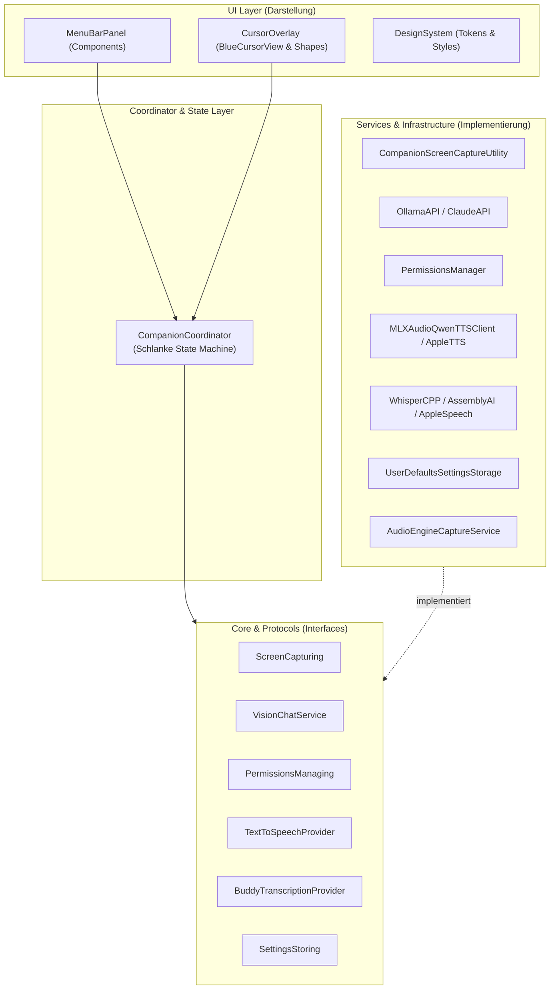

# Refactoring & Architektur-Spezifikation: Clicky (leanring-buddy)

- **Datum**: 2026-10-13
- **Status**: Genehmigt
- **Ziel**: Modularisierung des bisher monolithischen macOS-Menüleisten-Codes (~10.650 Zeilen in 27 flachen Dateien), Einführung einer sauberen Ordnerstruktur, Entkopplung von "God Objects" via Dependency Injection und Etablierung einer umfassenden Swift-Testing-Suite.

---

## 1. Problemstellung & Motivation

Clicky ist als leichtgewichtige macOS-Menüleisten-Applikation gestartet, hat jedoch durch Erweiterungen (mehrere TTS-Engines wie MLX/Kokoro/Apple Speech, lokale Vision-LLMs über Ollama, Apple Vision OCR, Multi-Monitor-Pointing) stark an Komplexität gewonnen.

### Aktuelle Schmerzpunkte
1. **Flache Projektstruktur**: Sämtliche 27 Swift-Dateien liegen unsortiert auf oberster Ebene von `leanring-buddy/`.
2. **God Objects mit multiplen Verantwortlichkeiten**:
   - `CompanionManager.swift` (1.298 Zeilen): Hält den gesamten UI-Zustand, triggert Audiowiedergabe (`ff.mp3`), führt Netzwerk-Calls (PostHog, FormSpark) aus, pollt Systemberechtigungen und koordiniert die PTT-Pipeline.
   - `OverlayWindow.swift` (1.049 Zeilen): Vermischt Low-Level AppKit-Window-Management (`NSWindow`, `NSScreen`) mit einer 800-Zeilen SwiftUI-View (`BlueCursorView`), Bezier-Flugphysik und UI-Shapes.
   - `CompanionPanelView.swift` (1.016 Zeilen): Monolithische View mit allen Sektionen (Permissions, Models, TTS, Audio-Audition, Footer) in einer einzigen Datei.
   - `BuddyDictationManager.swift` (866 Zeilen): Koppelt hardwarenahes Audio-Recording (`AVAudioEngine`), Audio-Puffer-Konvertierung und Session-Koordination eng aneinander.
   - `DesignSystem.swift` (880 Zeilen): Tokens, 7 verschiedene `ButtonStyle`-Structs und AppKit-Bridges in einer Datei.
3. **Mangelnde Testbarkeit**: Fast alle Klassen instanziieren ihre Abhängigkeiten fest (z. B. `let manager = BuddyDictationManager()`, `UserDefaults.standard`). Daher existieren derzeit nur 94 Zeilen Unit-Tests für isolierte Hilfsfunktionen.

---

## 2. Zielarchitektur: Modulare Clean Architecture

Die neue Architektur trennt Verantwortlichkeiten in vier horizontale Schichten:



### Kernprinzipien
1. **Dependency Injection**: Services werden über Protokolle an den `CompanionCoordinator` übergeben. Für SwiftUI-Views stehen Standard-Initialisierer mit Produktiv-Defaults bereit (`init(permissionsManager: any PermissionsManaging = PermissionsManager(), ...)`).
2. **Testbarkeit via Mocks**: Jedes externe Subsystem (Audio-Hardware, ScreenCaptureKit, Vision-LLM, Systemberechtigungen, `UserDefaults`) lässt sich im Test durch Mocks ersetzen.
3. **Single Responsibility**: Jede Datei hat genau eine Kernaufgabe und bleibt in der Regel unter 300–400 Zeilen.

---

## 3. Ziel-Ordnerstruktur & Dateizuordnung

Da das Xcode-Projekt `PBXFileSystemSynchronizedRootGroup` (Xcode 16) verwendet, werden Verzeichnisse im Dateisystem automatisch in Xcode als Gruppen synchronisiert.

```text
leanring-buddy/
├── App/                                   # App-Lifecycle & Einstiegspunkte
│   ├── leanring_buddyApp.swift            # Menüleisten-App Einstiegspunkt
│   └── AppBundleConfiguration.swift       # Runtime-Konfiguration (Info.plist)
│
├── Core/                                  # Reine Domänenmodelle & Interfaces
│   ├── Models/
│   │   ├── CompanionVoiceState.swift      # enum CompanionVoiceState (idle, listening, processing, responding)
│   │   ├── PointingDetection.swift        # Parsed Pointing-Strukturen & Bildschirm-Koordinaten
│   │   └── TTSModelCatalog.swift          # TTS-Katalog, Stimmen- & Sprach-Metadaten
│   └── Protocols/                         # Interfaces für Entkopplung & Mocks
│       ├── ScreenCapturing.swift          # Bildschirm-Capture Interface
│       ├── VisionChatService.swift        # Vision-LLM Streaming Interface
│       ├── PermissionsManaging.swift      # TCC-Permissions Interface
│       ├── SettingsStoring.swift          # Key-Value Persistenz Interface
│       ├── TextToSpeechProvider.swift     # TTS-Protokoll (bestehend)
│       └── BuddyTranscriptionProvider.swift # STT-Protokoll (bestehend)
│
├── State/                                 # Zustandsverwaltung & Orchestrierung
│   └── CompanionCoordinator.swift         # Schlanker Koordinator (~250-300 Zeilen)
│
├── Services/                              # Konkrete Service-Implementierungen
│   ├── Audio/                             # Mikrofonaufnahme & Hardware-Audio
│   │   ├── AudioEngineCaptureService.swift # Low-Level AVAudioEngine Input Node
│   │   ├── AudioPowerMeter.swift          # RMS / Dezibel-Berechnung für Waveform
│   │   ├── BuddyDictationManager.swift    # Diktat-Session & Provider-Koordination
│   │   ├── BuddyAudioConversionSupport.swift # PCM16 / WAV Konvertierung
│   │   └── OnboardingAudioPlayer.swift    # ff.mp3 Playback & Lautstärke-Fade
│   ├── SpeechSynthesis/                   # TTS-Provider & Satzsegmentierung
│   │   ├── MLXAudioQwenTTSClient.swift    # Lokale MLX-TTS
│   │   ├── MLXAudioServerManager.swift    # Subprozess-Manager für mlx_audio.server
│   │   ├── AppleTTSClient.swift           # Native macOS Fallback-TTS
│   │   ├── ElevenLabsTTSClient.swift      # Cloud-TTS
│   │   └── SpeechSentenceSegmenter.swift  # Streaming-Segmenter & [POINT]-Filter
│   ├── Transcription/                     # STT-Provider
│   │   ├── WhisperCPPTranscriptionProvider.swift # Lokales Whisper
│   │   ├── AppleSpeechTranscriptionProvider.swift # Apple Speech
│   │   ├── AssemblyAIStreamingTranscriptionProvider.swift # AssemblyAI WebSocket
│   │   └── OpenAIAudioTranscriptionProvider.swift # OpenAI Audio API
│   ├── VisionAndAI/                       # Vision-LLMs & Screen-Analyse
│   │   ├── OllamaAPI.swift                # Lokales Ollama Streaming
│   │   ├── ClaudeAPI.swift                # Anthropic API Client
│   │   ├── OpenAIAPI.swift                # OpenAI API Client
│   │   └── ElementLocationDetector.swift  # UI Element Detektion
│   ├── ScreenCapture/                     # Bildschirmaufnahme & OCR
│   │   └── CompanionScreenCaptureUtility.swift # ScreenCaptureKit & Vision OCR
│   ├── System/                            # Shortcuts, Permissions, Fenster
│   │   ├── GlobalPushToTalkShortcutMonitor.swift # CGEvent Tap Monitor
│   │   ├── PermissionsManager.swift       # Polling & TCC Statusprüfung
│   │   └── WindowPositionManager.swift    # Fensterplatzierung & System-Settings Links
│   ├── Storage/                           # Persistenz
│   │   └── UserDefaultsSettingsStorage.swift # SettingsStoring Implementierung
│   └── Analytics/                         # Telemetrie & Onboarding-Formular
│       ├── ClickyAnalytics.swift          # PostHog Integration
│       └── OnboardingLeadService.swift    # FormSpark REST-Call & Lead Identification
│
├── UI/                                    # Reine Darstellung
│   ├── DesignSystem/                      # Design-Tokens & globale Stile
│   │   ├── Colors.swift                   # DS.Colors
│   │   ├── Typography.swift               # DS.Typography
│   │   ├── Metrics.swift                  # DS.CornerRadius, DS.Spacing, DS.Shadows
│   │   ├── ButtonStyles.swift             # DSPrimaryButtonStyle, etc.
│   │   └── AppKitBridges.swift            # IBeamCursorView, Hover-Helfer
│   ├── MenuBarPanel/                      # Statusleisten-Dropdown
│   │   ├── MenuBarPanelManager.swift      # NSStatusItem & NSPanel-Bridge
│   │   ├── CompanionPanelView.swift       # Schlanker Container (~120 Zeilen)
│   │   └── Components/
│   │       ├── PanelHeaderView.swift      # Status-Pille, Titel, Icon
│   │       ├── PanelPermissionsCard.swift # TCC-Berechtigungen & Erlauben-Buttons
│   │       ├── PanelModelPickerSection.swift # Ollama VLM Dropdown
│   │       ├── PanelTTSVoiceSection.swift # TTS-Modell, Stimme, Audition, Speed
│   │       └── PanelFooterSection.swift   # Clicky Toggle, Quit-Button
│   └── CursorOverlay/                     # Transparenter Begleiter
│       ├── OverlayWindow.swift            # NSWindow Subklasse
│       ├── OverlayWindowManager.swift     # Multi-Screen Window Management
│       ├── BlueCursorView.swift           # Kern-SwiftUI Cursor View
│       ├── CursorFlightAnimator.swift     # Bezier- & Flugberechnungen
│       ├── CursorSpeechBubbleView.swift   # Sprechblase bei [POINT]
│       ├── CursorShapes.swift             # Triangle, PreferenceKeys
│       └── CompanionResponseOverlay.swift # Textbubble & Waveform
│
├── Resources/                             # Bundled Assets
│   ├── Audio/ (enter.mp3, eshop.mp3, ff.mp3)
│   └── Images/ (steve.jpg, codex-add-project.png)
│
├── Assets.xcassets                        # Bleibt im Root für Build-Settings
├── Info.plist                             # Bleibt im Root für Build-Settings
└── leanring-buddy.entitlements             # Bleibt im Root für Build-Settings
```

---

## 4. Test-Architektur (Swift Testing)

Alle Tests nutzen Apples modernes Swift Testing Framework (`import Testing`, `@Test`, `#expect`, `@Suite`).

### Mocks (`leanring-buddyTests/Mocks/`)
1. **`MockPermissionsManager`**: Simuliert beliebige Berechtigungskombinationen.
2. **`MockVisionChatService`**: Liefert konfigurierte Token-Streams (inklusive `[POINT:x,y:label:screenN]`) oder simulierte Fehler.
3. **`MockTextToSpeechProvider`**: Zeichnet gesprochene Sätze und Lautstärken ohne Audioausgabe auf.
4. **`MockTranscriptionProvider`**: Simuliert Diktatergebnisse deterministisch.
5. **`MockSettingsStorage`**: In-Memory-Speicher (`[String: Any]`), verhindert Seiteneffekte auf echte User-Defaults.
6. **`MockScreenCaptureUtility`**: Gibt Test-Screenshots ohne ScreenCaptureKit zurück.

### Geplante Test-Suiten (`leanring-buddyTests/UnitTests/`)
- **`CoordinatorStateMachineTests.swift`**:
  - Zustandsübergänge: `idle` ➔ `listening` ➔ `processing` ➔ `responding` ➔ `idle`.
  - Abbruch-Verhalten ("Barge-In"): Neuer Tastendruck während der Antwort bricht laufende LLM-Tasks ab und startet neue Diktat-Session.
  - Permissions-Gate: Verhindert Aktivierung bei fehlenden Berechtigungen.
- **`SpeechSentenceSegmenterTests.swift`**:
  - Pufferung unvollständiger Chunks über Streaming-Zyklen.
  - Deutsche Abkürzungen ("z. B.", "ca.", "bzw.", "Dr.").
  - Extraktion und Entfernung von `[POINT:x,y:label:screenN]` aus dem gesprochenen Text.
- **`PointingParserTests.swift`**:
  - Validierung des 0–1000 Wertebereichs, Screen-Index-Zuweisung und Fallback-Verhalten.
- **`TTSCatalogAndSelectionTests.swift`**:
  - Modellauswahl (Qwen3, Kokoro, Apple Speech), automatische Sprachanpassung und Stimmen-Fallback.
- **`AudioMeteringTests.swift`**:
  - RMS-Berechnung für Audiosignale zur Waveform-Visualisierung.

---

## 5. Implementierungs-Roadmap (Task-Aufteilung für Agenten)

Die Migration erfolgt in 5 logischen Arbeitspaketen:

### Task 1: Struktur-First – Verzeichnisse anlegen & bestehende Dateien einsortieren
- Physikalische Verzeichnisse (`App/`, `Core/`, `Services/`, `UI/`, `Resources/`) erstellen.
- Bestehende 27 Dateien in ihre jeweiligen Zielordner verschieben.
- Build im Xcode verifizieren (dank `PBXFileSystemSynchronizedRootGroup` nahtlos).

### Task 2: Core-Protokolle, In-Memory-Storage & Mock-Fundament
- `Core/Protocols/` implementieren (`ScreenCapturing`, `VisionChatService`, `PermissionsManaging`, `SettingsStoring`).
- `MockPermissionsManager`, `MockVisionChatService`, `MockTextToSpeechProvider`, `MockSettingsStorage` in `leanring-buddyTests/Mocks/` anlegen.
- Erste Unit-Tests für `SpeechSentenceSegmenter` und `TTSModelCatalog` konsolidieren.

### Task 3: Services aus `CompanionManager` & `BuddyDictationManager` extrahieren
- `PermissionsManager`, `OnboardingAudioPlayer`, `OnboardingLeadService` herauslösen.
- `AudioEngineCaptureService` und `AudioPowerMeter` aus `BuddyDictationManager` herauslösen.
- `CompanionManager` mit Dependency Injection aufschlanken (Zustandsmaschine).
- `CoordinatorStateMachineTests` schreiben und ausführen.

### Task 4: UI-Monolithen zerlegen
- `OverlayWindow.swift` in `OverlayWindow`, `OverlayWindowManager`, `BlueCursorView`, `CursorFlightAnimator` und `CursorShapes` aufteilen.
- `CompanionPanelView.swift` in `CompanionPanelView` und die 5 Komponenten-Views aufteilen.
- `DesignSystem.swift` in `Colors`, `Typography`, `Metrics`, `ButtonStyles`, `AppKitBridges` aufteilen.

### Task 5: Vollständige Test-Suite & Dokumentation
- Alle Unit-Test-Suiten vervollständigen (`PointingParserTests`, `TTSCatalogAndSelectionTests`, `AudioMeteringTests`).
- `AGENTS.md` aktualisieren (neue Dateiliste, Zeilenzahlen, Verzeichnisstruktur).
- Finale Verifikation.
